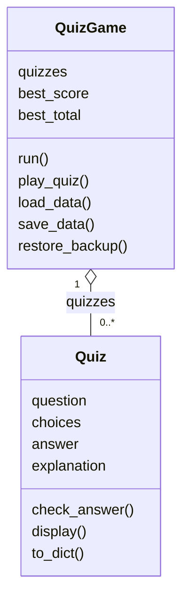

# 🌀 주술회전 설정 모티브 탐구 퀴즈

## 1. 프로젝트 개요

일본 애니메이션·만화 **《주술회전》**의 세계관에 활용되거나 연상되는 문화적 소재를 실제 역사·종교·민속 자료와 연결해 알아보는 Python 콘솔 퀴즈 게임입니다.

애니메이션의 줄거리나 캐릭터 이름을 맞히는 데서 그치지 않고, 양면숙나 전승, 음양도와 식신, 불교 및 일본 신앙의 상징, 작가 인터뷰에 언급된 신화적 영향 등을 살펴보도록 구성했습니다.

> 작품 속 설정은 실제 종교·역사와 동일하지 않습니다. 문제와 해설에서는 역사 기록, 지역 전승, 작가 발언, 해석을 구분합니다.

## 2. 실행 환경 및 실행 방법

- Python 3.10 이상
- 외부 라이브러리 설치 불필요(Python 표준 라이브러리만 사용)
- Windows PowerShell, 명령 프롬프트, macOS/Linux 터미널 지원

```bash
python main.py
```

Windows에서 `python` 명령이 연결되어 있지 않다면:

```powershell
py main.py
```

## 3. 기능 목록

| 메뉴 | 기능 |
|---|---|
| 1. 퀴즈 풀기 | 등록된 문제를 무작위 순서로 출제하고 정답·오답 및 해설 표시 |
| 2. 퀴즈 추가 | 문제, 선택지 4개, 정답 번호를 입력해 새 퀴즈 등록 |
| 3. 퀴즈 목록 | 등록된 모든 문제 확인 |
| 4. 최고 점수 확인 | 최고 정답 수와 당시 전체 문제 수 확인 |
| 5. 종료 | 종료 전에 저장하고 성공/실패 결과 출력 |
| 6. 백업 데이터 복원 | 사용자가 확인한 뒤 `state.json.bak` 복원 |

### 메뉴 선택 사용 흐름 예시

```text
실행: python main.py
선택: 3       # 퀴즈 목록 확인
선택: 1       # 퀴즈 풀기 → 문제별 1~4 입력 → 결과 확인
선택: 4       # 최고 점수 확인
선택: 5       # 저장 결과 확인 후 종료
```

위 흐름은 사용 방법 예시이며, 실제 실행 결과 캡처는 `docs/screenshots/`에 별도로 첨부합니다.

## 4. 입력 검증 및 경계 사례

숫자 입력은 앞뒤 공백을 제거한 후 정수로 변환하고, 지정 범위 안에 있을 때만 처리합니다.

| 입력 사례 | 예시 | 기대 동작 |
|---|---|---|
| 정상 입력 | `3`, ` 3 ` | 정수 3으로 처리 |
| 빈 입력 | 빈 문자열 또는 공백만 입력 | 빈 입력 안내 후 재입력 |
| 숫자가 아닌 문자 | `abc`, `가` | 숫자 안내 후 재입력 |
| 소수 | `2.5` | 정수 변환 실패 안내 후 재입력 |
| 범위보다 작음 | 메뉴에서 `0`, 정답에서 `-1` | 허용 범위 안내 후 재입력 |
| 범위보다 큼 | 메뉴에서 `7`, 정답에서 `5` | 허용 범위 안내 후 재입력 |
| 입력 스트림 종료 | `Ctrl+C`, EOF | 저장을 시도하고 안전 종료 |

자동 테스트는 빈 입력·문자·범위 초과·공백 입력을 확인합니다. 실행 방법은 `docs/verification.md`를 참고하세요.

## 5. 프로젝트 파일 구조

```text
jujutsu_motifs_quiz/
├── main.py
├── quiz.py
├── quiz_game.py
├── state.json
├── README.md
├── .gitignore
├── docs/
│   ├── architecture.md
│   ├── quiz_design.md
│   ├── sources.md
│   ├── verification.md
│   ├── screenshots/
│   │   └── README.md
│   └── evidence/
├── scripts/
│   └── collect_git_evidence.py
└── tests/
    └── test_quiz_game.py
```

실행 시 `logs/quiz_game.log`, 백업 파일 `state.json.bak`이 생성될 수 있습니다. 해당 파일들은 `.gitignore`에서 제외합니다.

## 6. 데이터 저장 구조 및 스키마 버전

`state.json`은 UTF-8 JSON 파일이며 `ensure_ascii=False`로 기록해 한글을 읽기 쉽게 유지합니다.

| 키 | 자료형 | 설명 |
|---|---|---|
| `schema_version` | int | 저장 구조 버전(현재 1) |
| `quizzes` | list[object] | 퀴즈 객체 목록 |
| `quizzes[].question` | str | 문제 문장 |
| `quizzes[].choices` | list[str] | 네 개의 선택지 |
| `quizzes[].answer` | int | 정답 번호(1~4) |
| `quizzes[].explanation` | str | 정답 해설 |
| `best_score` | int 또는 null | 최고 정답 수 |
| `best_total` | int 또는 null | 최고 기록 당시 전체 문제 수 |

### 중첩 목록 구조를 선택한 이유

문제별 네 속성을 한 객체에 묶으면 데이터의 의미가 분명하고, 문제 순서를 유지하면서 전체 목록을 저장·불러오기 쉽습니다. 소규모 퀴즈에서는 별도 DB 없이 간단히 관리할 수 있습니다. 반면 특정 문구 검색은 목록 전체를 순회해야 하고 파일 전체를 메모리에 올려야 하므로, 데이터가 커지면 검색 비용과 메모리 부담이 증가합니다.

### 스키마 마이그레이션

기존 파일처럼 `schema_version`이 없는 데이터는 버전 0으로 간주하고 읽은 뒤 버전 1로 다시 저장합니다. 향후 데이터 구조를 바꾸면 `SCHEMA_VERSION`을 올리고 `quiz_game.py`의 `_decode_state_file()`에 구버전 변환 규칙을 추가합니다. 지원하지 않는 미래 버전은 무시하거나 덮어쓰지 않고 오류로 처리합니다.

### JSON의 한계와 대안

JSON은 설정이 쉽고 사람이 직접 읽기 좋지만, 대용량 데이터에서는 전체 파일 파싱·직렬화와 메모리 사용 비용이 커집니다. 여러 프로세스가 동시에 같은 파일을 쓰면 변경사항이 덮어써질 수 있습니다.

- **SQLite:** 서버 없이 트랜잭션과 인덱스를 제공하므로 중소 규모 데이터에 적합하지만 SQL 및 마이그레이션 관리가 필요합니다.
- **RDBMS:** 다중 사용자와 복잡한 검색에 적합하지만 서버 운영·권한·백업 설정이 추가됩니다.
- **JSONL/스트리밍:** 레코드 단위 처리가 가능해 메모리를 줄일 수 있지만 임의 검색·수정은 불편합니다.

현재 프로그램은 단일 사용자·단일 프로세스를 가정하며 파일 잠금은 구현하지 않았습니다. 동시 접근이 필요한 환경에서는 파일 잠금 또는 SQLite 트랜잭션으로 전환해야 합니다. 자세한 비교는 `docs/architecture.md`에 있습니다.

## 7. 저장 안전성, 백업, 오류 로그

- `save_data()`는 임시 파일에 먼저 기록한 뒤 `replace()`로 교체합니다.
- 기존 `state.json`을 교체하기 전에 `state.json.bak`으로 백업합니다.
- 메뉴 6에서 복원 여부를 확인한 후 백업을 검증하고 복원합니다.
- 저장 파일이 손상되면 유효한 백업이 있는지 확인하고, 없으면 기본 퀴즈 12개로 복구합니다.
- 종료 시 저장 성공/실패를 사용자에게 표시합니다.
- `logs/quiz_game.log`에 시간, 오류 코드, 상세 예외를 기록합니다.

주요 로그 코드: `DATA_LOAD_FAILED`, `DATA_SAVE_FAILED`, `BACKUP_LOAD_FAILED`, `BACKUP_RESTORE_FAILED`, `INPUT_INTERRUPTED`, `UNHANDLED_EXCEPTION`. 로그 파일을 공유하기 전 개인 정보나 비밀정보가 포함되어 있지 않은지 확인하세요.

## 8. 클래스 책임 및 설계 선택

### `Quiz`

- 속성: `question`, `choices`, `answer`, `explanation`
- 메서드: `display()`, `check_answer()`, `show_explanation()`, `to_dict()`, `from_dict()`
- 책임: 개별 퀴즈 데이터의 검증, 표시, 정답 판정 및 JSON 변환

### `QuizGame`

- 속성: `state_path`, `backup_path`, `quizzes`, `best_score`, `best_total`
- 메서드: `load_data()`, `save_data()`, `restore_backup()`, `show_menu()`, `play_quiz()`, `add_quiz()`, `show_quizzes()`, `show_score()`, `run()` 등
- 책임: 게임 전체 흐름, 입력 처리, 점수, 파일 입출력 및 복구

`Quiz`는 한 문제의 데이터와 동작을 캡슐화하고, `QuizGame`은 문제 목록과 게임 흐름을 관리합니다. 객체지향 방식은 관련 데이터와 기능을 묶어 확장·검증하기 쉽지만 클래스 구조와 메서드가 늘어나는 비용이 있습니다. 작은 일회성 프로그램은 딕셔너리와 함수만으로도 구현할 수 있습니다. 현재 프로젝트는 문제별 검증·표시·직렬화 책임이 있어 클래스를 사용하는 편이 적절하다고 판단했습니다.



## 9. 변경 영향 범위 및 테스트 체크리스트

| 요구사항 변경 | 주요 파일·메서드 | 함께 확인할 테스트 |
|---|---|---|
| 문제 속성 추가 | `quiz.py`의 `__init__()`, `to_dict()`, `from_dict()` | 생성·검증·직렬화 테스트, 기존 state 마이그레이션 |
| 정답 규칙 변경 | `quiz.py:check_answer()`, `quiz_game.py:play_quiz()` | 정답/오답 테스트 |
| 입력 범위·안내 변경 | `quiz_game.py:input_number()`, `run()`, `play_quiz()` | 빈 값·문자·최소/최대 경계 테스트 |
| 메뉴 추가/변경 | `show_menu()`, `run()` | 메뉴 통합 흐름 테스트 |
| JSON 필드 변경 | `SCHEMA_VERSION`, `_decode_state_file()`, `save_data()` | 저장/불러오기·구버전 이행 테스트 |
| 백업 정책 변경 | `save_data()`, `restore_backup()`, `load_data()` | 백업 생성·복원·손상 파일 테스트 |
| 오류 처리 변경 | `main.py`, `log_event()` | Ctrl+C/EOF 및 로그 수동 확인 |

## 10. 테스트 실행

```bash
python -m unittest discover -s tests -v
```

기본 퀴즈 개수만 별도로 확인:

```bash
python -c "from quiz_game import QuizGame; print('기본 퀴즈 수:', len(QuizGame.default_quizzes()))"
```

기대 결과는 `기본 퀴즈 수: 12`입니다. 테스트 내용과 수동 점검표는 `docs/verification.md`에 정리했습니다.

## 11. Git 작업 이력, 원격 저장소 및 제출 증빙

### 원격 저장소 연결과 push

아래 주소는 예시 형식이며 실제 저장소 URL로 교체해야 합니다.

```bash
git remote -v
git remote add origin https://github.com/본인계정/저장소이름.git
# 이미 origin이 있으면 add 대신 set-url 사용
git remote set-url origin https://github.com/본인계정/저장소이름.git
git push -u origin main
```

### 실제 증빙 자동 수집

프로젝트 루트에서 실행:

```bash
python scripts/collect_git_evidence.py
```

실제 저장소의 `git remote -v`, `git status`, `git branch -vv`, `git log --oneline --graph --decorate --all`, `git ls-remote --heads origin` 결과를 `docs/evidence/git-evidence.txt`에 기록합니다. 생성된 파일을 확인한 뒤 README 및 제출 자료와 함께 첨부하세요. 원격 URL이나 push 결과는 사용자의 GitHub 저장소에서 확인되어야 하므로 이 ZIP에는 가상의 주소·로그를 넣지 않았습니다.

### 커밋 메시지 규칙

`타입(범주): 변경 내용을 동사형으로 요약` 형식을 사용합니다.

```text
Feat(quiz): 퀴즈 추가 기능 구현
Fix(storage): 손상된 JSON 복구 처리
Docs(readme): 실행 및 테스트 절차 보완
Test(game): 메뉴 통합 테스트 추가
Refactor(input): 숫자 입력 검증 분리
```

권장 타입은 `Feat`, `Fix`, `Docs`, `Test`, `Refactor`, `Chore`입니다. 한 커밋에는 하나의 논리적 변경만 포함하고, 메시지는 무엇을 바꿨는지 구체적으로 작성합니다.

### 브랜치·병합 정책

1. `main`은 실행 가능한 상태를 유지합니다.
2. 기능은 `feature/<기능명>` 브랜치에서 작업합니다.
3. 병합 전에 자동 테스트를 실행하고 README·테스트를 함께 갱신합니다.
4. 개인 과제 저장소에서는 별도 리뷰어가 없으면 자체 점검 후 병합할 수 있습니다. 팀 작업에서는 최소 1명의 리뷰를 권장합니다.
5. 제출 이력을 보존해야 하는 과제이므로 기본은 일반 merge commit을 권장합니다. 커밋 수 보존 요구가 없고 이력을 정리해야 하는 팀에서는 squash merge를 합의 후 사용합니다.
6. 충돌이 발생하면 양쪽 변경을 확인하고 테스트를 다시 실행한 뒤 병합합니다.

### clone / pull 실습

```bash
git clone https://github.com/본인계정/저장소이름.git quiz-clone-practice
cd quiz-clone-practice
git pull origin main
```

별도 clone 폴더에서 README를 수정하고 커밋·push한 뒤 원본 폴더에서 `git pull origin main`을 실행해 변경사항이 반영되는지 확인합니다. 실습 기록은 실제 수행 결과로 남겨야 합니다.

## 12. 제출 스크린샷 목록

실제 본인 PC에서 캡처한 파일을 `docs/screenshots/`에 넣습니다.

- `menu.png`: 실행 및 메뉴
- `play.png`: 퀴즈 출제 및 결과
- `add_quiz.png`: 퀴즈 추가
- `score.png`: 최고 점수
- `backup.png`: 백업 복원
- `git-log.png`: 브랜치 그래프와 커밋 로그
- `git-remote.png`: 원격 URL
- `git-push.png`: push 성공 결과

상세한 캡처 기준은 `docs/screenshots/README.md`를 참고하세요. 이 ZIP에는 실제 사용자 환경에서만 생성 가능한 스크린샷과 GitHub push 증빙을 임의로 만들어 넣지 않았습니다.

## 13. 참고 문서

- `docs/architecture.md`: 클래스 구조, 책임 분리, JSON 대안, 동시성, 백업·복구
- `docs/quiz_design.md`: 기본 퀴즈 12개와 주제 설계
- `docs/sources.md`: 문제별 출처 기록 양식
- `docs/verification.md`: 자동 테스트 및 수동 검증 절차
- `docs/git-practice-log.md`: 브랜치·병합·원격 증빙 생성 절차
- `docs/screenshots/README.md`: 실제 제출용 캡처 가이드
