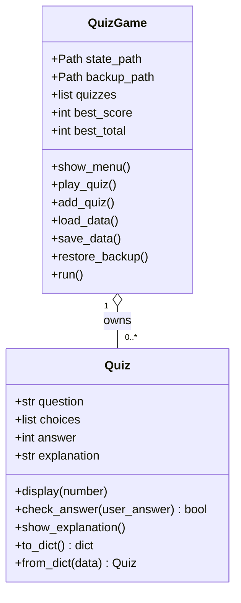

# 설계 보완 문서

## 1. 클래스 책임 및 객체지향 선택

`Quiz`는 한 문제의 데이터와 문제별 동작을 묶어 유효성 검증·정답 판정·직렬화를 담당합니다. `QuizGame`은 여러 `Quiz` 객체를 보유하면서 메뉴, 게임 순서, 점수, 저장·복원을 담당합니다.

**객체지향의 이점:** 문제 데이터와 관련 동작이 한 객체에 모여 있어 잘못된 정답 번호나 선택지 개수를 생성 시점에 막을 수 있습니다(캡슐화). 문제 속성이 늘어날 때 `Quiz`의 직렬화 메서드를 중심으로 수정할 수 있고, 다른 유형의 문제 클래스를 추가하는 확장도 가능합니다.

**함수 기반 대안과 절충:** 문제를 딕셔너리로 보관하고 `check_answer(question, answer)` 같은 함수로 처리하면 작은 스크립트에서는 코드가 짧고 단순합니다. 다만 데이터 구조 검증과 함수 인자 전달이 여러 곳으로 흩어질 수 있습니다. 현재처럼 문제별 데이터와 동작이 함께 있고 JSON 변환도 필요한 규모에서는 `Quiz` 객체를 쓰는 편이 책임을 분명히 합니다. 반면 단순한 일회성 퀴즈라면 함수+딕셔너리 구조가 더 가벼울 수 있습니다.

## 2. 입력 검증과 데이터 I/O 분리 기준

- `input_number()`, `input_non_empty()`: 사용자 입력 형식과 허용 범위만 검증합니다. 입력 범위나 안내 문구를 바꿔도 JSON 저장 형식에는 영향이 없어야 합니다.
- `_decode_state_file()`, `load_data()`, `save_data()`, `restore_backup()`: 파일 형식, 스키마 버전, 손상 복구 및 저장 안정성을 담당합니다. 저장 위치나 JSON 구조가 바뀌어도 메뉴 출력과 정답 판정은 유지할 수 있도록 분리했습니다.
- 입력 규칙 변경 시 영향: `input_number()` 호출 지점과 `tests/test_quiz_game.py`의 경계값 테스트.
- 저장 규칙 변경 시 영향: `SCHEMA_VERSION`, `_decode_state_file()`, `save_data()`, `state.json`, 스키마 테스트.

## 3. JSON 중첩 목록 구조 선택

`quizzes`를 `list[dict]` 구조로 둔 이유는 문제의 출제 순서를 유지하고, 전체 문제를 한 번에 읽고 쓰며, 각 문제에 `question`, `choices`, `answer`, `explanation`을 묶어 표현하기 쉽기 때문입니다. 문제 수가 적은 현재 프로젝트에서는 구현이 단순합니다.

단점은 특정 키워드의 문제를 자주 검색할 때 전체 목록을 순회해야 한다는 점과, 데이터 전체를 메모리에 읽고 저장해야 한다는 점입니다. 중복 문제 검출이나 복잡한 조건 검색을 추가한다면 인덱스 또는 별도 데이터 저장소가 필요할 수 있습니다.

## 4. JSON 저장의 한계와 대안

현재 JSON은 외부 DB 설치 없이 읽기 쉽고, 소규모 단일 사용자 퀴즈에 충분합니다. 하지만 파일이 커질수록 전체 파일 파싱·직렬화에 시간이 걸리고 메모리 사용량이 증가합니다. 여러 프로세스가 동시에 같은 파일을 수정하면 마지막 쓰기가 앞선 변경을 덮어쓸 수 있습니다.

- **SQLite:** 별도 서버 없이 트랜잭션과 인덱스를 사용할 수 있어 중소 규모 데이터와 동시 접근 제어에 유리합니다. 대신 SQL 스키마·마이그레이션·쿼리 코드를 관리해야 합니다.
- **RDBMS(예: PostgreSQL):** 다중 사용자·서버형 서비스와 복잡한 조회에 적합합니다. 다만 DB 서버 운영, 계정·권한, 백업·배포 관리가 추가됩니다.
- **스트리밍/라인 단위 JSON(JSONL):** 큰 데이터를 한 줄씩 처리할 수 있어 메모리 사용을 줄이는 데 유리하지만, 전체 데이터 정렬·수정·관계형 검색은 불편합니다.

현재 구현은 단일 프로세스 사용을 전제로 하며 파일 잠금은 구현하지 않았습니다. 같은 저장 파일을 여러 인스턴스가 동시에 변경해야 하는 운영 환경에서는 OS 파일 잠금 또는 SQLite 트랜잭션으로 전환해야 합니다.

## 5. 스키마 버전 및 마이그레이션

현재 저장 파일은 최상위 `schema_version: 1`을 가집니다. 버전 필드가 없는 기존 파일은 버전 0으로 취급하고, 읽은 뒤 버전 1 구조로 다시 저장합니다. 향후 필드 형식이 바뀌면 `SCHEMA_VERSION`을 올리고 `_decode_state_file()`에 구버전 변환 규칙을 추가합니다. 지원하지 않는 미래 버전은 임의로 덮어쓰지 않고 오류로 처리합니다.

## 6. 백업과 복구

기존 `state.json`을 새 데이터로 교체하기 전에 `state.json.bak`으로 복사합니다. 메뉴 6에서 사용자가 복원을 명시적으로 선택하면 백업을 검증한 뒤 복원합니다. 자동 복구는 현재 저장 파일이 손상되었고 백업이 유효한 경우에만 시도합니다. `.bak` 파일은 Git에 올리지 않도록 `.gitignore`에 등록했습니다.

## 7. 오류 로그

`logs/quiz_game.log`에 시간, 오류 레벨, 오류 코드, 메시지, 예외 유형과 상세 추적을 기록합니다. 주요 코드: `DATA_LOAD_FAILED`, `DATA_SAVE_FAILED`, `BACKUP_LOAD_FAILED`, `BACKUP_RESTORE_FAILED`, `INPUT_INTERRUPTED`, `UNHANDLED_EXCEPTION`. 로그에는 비밀번호나 GitHub 토큰 등 비밀정보를 기록하지 않습니다.
